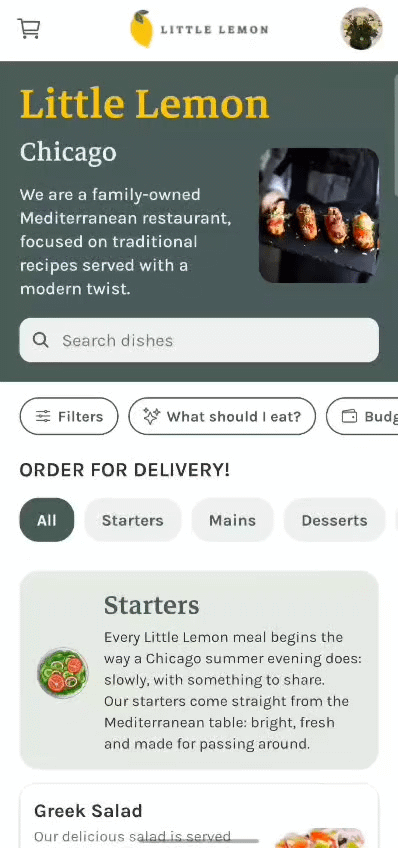
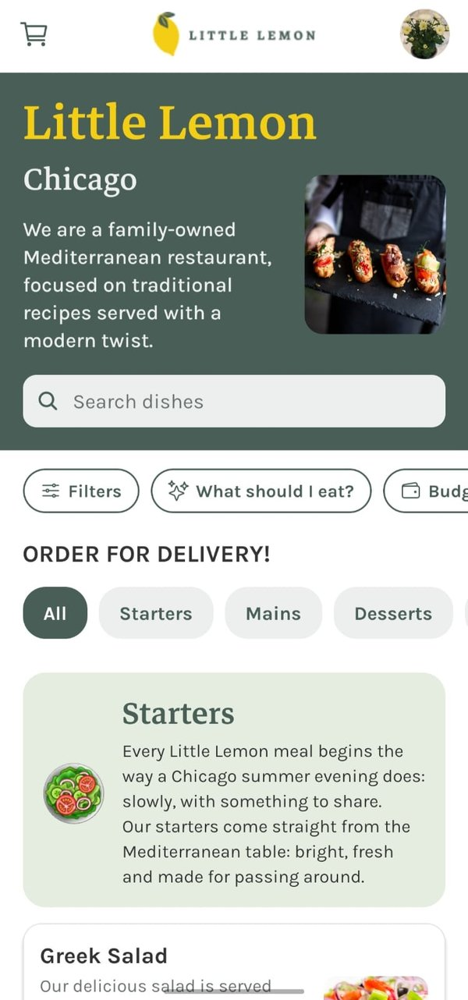
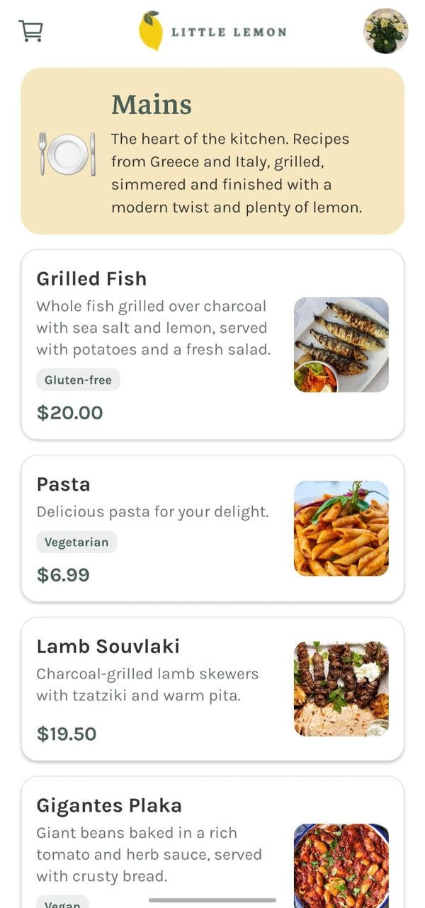
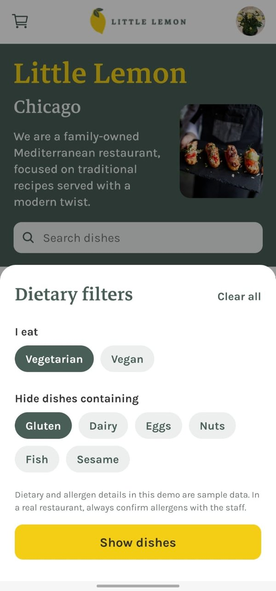
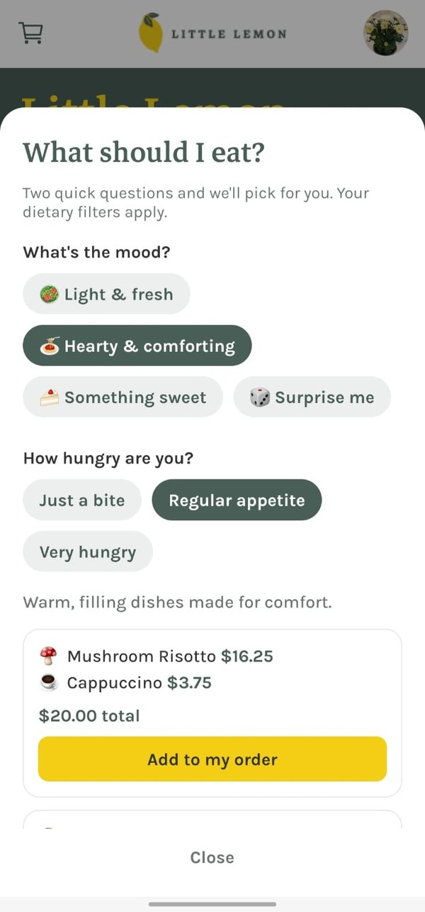
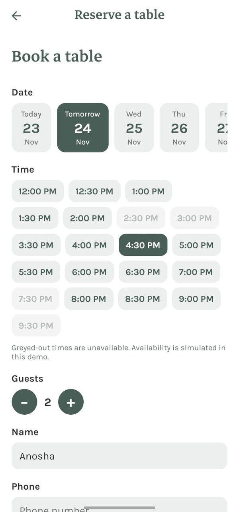
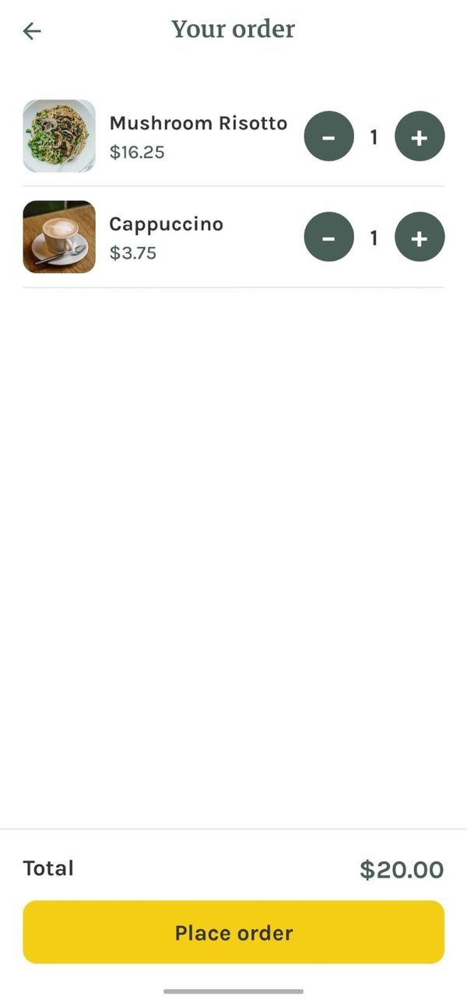

# 🍋 Little Lemon

A mobile app for the fictional Little Lemon restaurant in Chicago, built with React Native and Expo. It started as the capstone for the Meta React Native Specialization and grew into a full ordering experience: a story-style menu, dietary filters, a budget planner, a "What should I eat?" helper, table reservations and a cart.



<p>
  
  
  
</p>
<p>
  
  
  
</p>

## Features
- **Onboarding** with validated first name and email; the app remembers you and skips it next time
- **Story-style menu**: each category (Starters, Mains, Desserts, Drinks) opens with a themed banner and a short story, followed by dish cards with photos, dietary tags and prices
- **Dietary and allergen filters**: Vegetarian, Vegan, and hide dishes containing gluten, dairy, eggs, nuts, fish or sesame. Choices are remembered between launches
- **Budget planner**: enter a budget and group size and get meal combinations (main plus optional starter, dessert and drink) that fit per person, ready to add to the order
- **"What should I eat?" helper**: pick a mood and an appetite and get mini-meal suggestions that respect your filters. It's rule-based, so it needs no API
- **Table reservations**: choose a date, time and party size, add a note, and manage your bookings. Past times and double bookings are blocked
- **Ordering**: dish details, quantity steppers, a cart with a live badge, and a demo checkout. The cart survives app restarts
- **Profile**: edit personal info, masked phone input, avatar picker, notification preferences, and log out

## Design and quality
- Little Lemon brand palette and fonts (Markazi Text and Karla), kept in a shared `theme.js`
- **Works offline**: the menu data and 15 of the dish photos are bundled with the app. Only the photos for Greek Salad, Bruschetta and Pasta load from the web, and they fall back to an emoji if the network is unavailable
- **Loading states**: a pulsing placeholder and fade-in for remote images, a splash screen while fonts load, and empty states for the cart and search
- **Accessibility**: screen-reader labels and roles on buttons, inputs and filters, selected and disabled states announced, 44-pixel touch targets on the main controls, large-text friendly layouts, and reduced-motion support for animations
- **Error handling**: an error boundary shows a friendly screen instead of crashing

## Notes on the data
This is a portfolio project, so some things are simulated: dietary and allergen details are sample data (never rely on them for real allergies), reservation availability is generated, and checkout doesn't take payment.

## Tech stack
React Native · Expo · React Navigation (native stack) · AsyncStorage · expo-image-picker · react-native-mask-text · Google Fonts

## Run it
```bash
npm install
npx expo install --fix   # aligns package versions with your Expo SDK
npx expo start
```
Scan the QR code with Expo Go on your phone.

## Project structure
```
App.js                   navigation, fonts, onboarding/login state
theme.js                 brand colors + fonts
Screens/                 Onboarding, Home, ItemDetails, Cart, Reservations, Profile, Splash
components/              Header, Categories, MenuImage, QuantityStepper,
                         FiltersModal, BudgetModal, HelperModal, ErrorBoundary
context/CartContext.js   cart state (persisted)
utils/                   menu helpers, budget logic, recommender, reservation helpers, image map
menu.json                menu data
assets/                  logo, hero and dish photos
```

## Roadmap
- Reservation reminders (local notifications)
- Fetch the menu from a remote API with local caching
- Real checkout (payments and a backend)
- Arabic and English with right-to-left layout
